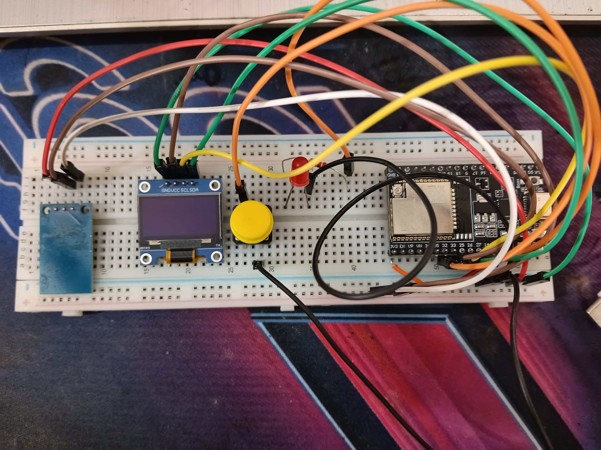

# ESP32 Reaction Timer

A small ESP32 project that tests your reaction speed. An LED lights up at a random moment, you hit a button or tap a touch sensor as fast as you can, and a 128x64 OLED shows your time in milliseconds.

## What it does

- Shows a "Press to start" screen on power-up
- Waits a random 2 to 5 seconds, then turns the LED on
- Measures the time between the LED turning on and your press (microsecond timer, shown in ms)
- Accepts input from either a push button or a touch sensor
- Shows "FOUL! Too early" if you press before the LED lights up
- Keeps track of your best time and shows it at the bottom of the screen

## Components used

- ESP32 Dev Module (CP2102 USB chip)
- 0.96" OLED display, SSD1306 driver, 128x64, I2C
- 1x LED + 220 ohm resistor
- 1x push button
- 1x TTP223 touch sensor module

## Wiring

All pins are on the left side of the ESP32 board.

| Part | ESP32 Pin |
|---|---|
| Button | GPIO 32 to GND |
| Touch sensor OUT | GPIO 33 |
| Touch sensor VCC / GND | 3V3 / GND |
| LED (with resistor) | GPIO 27 to GND |
| OLED SDA | GPIO 26 |
| OLED SCL | GPIO 25 |
| OLED VCC / GND | 3V3 / GND |

The ESP32 lets you assign I2C to almost any GPIO, so the OLED does not need the default pins 21 and 22.

## Libraries required

Install via Arduino IDE Library Manager:
- **Adafruit SSD1306**
- **Adafruit GFX Library** (installs automatically as a dependency)

## It Should Like This

## How to use

1. In Arduino IDE, select **Tools > Board > ESP32 Dev Module**.
2. Select the correct COM port under **Tools > Port**.
3. Upload `reaction_timer.ino`.
4. Press the button or touch the sensor to start a round.
5. Wait for the LED to turn on, then press or touch as fast as you can.
6. Your time appears on the OLED. Press again to start a new round.

## Troubleshooting

- **No COM port showing:** install the CP210x Universal Windows Driver from Silicon Labs, then replug the board.
- **Upload stuck on "Connecting...":** hold the **Boot** button until uploading starts.
- **OLED stays blank:** check SDA/SCL wiring, or try I2C address `0x3D` instead of `0x3C`.

## Known limitations

- The best time resets whenever the board is reset or powered off.
- Touch modules like the TTP223 can respond slightly slower than a button, so button times are usually more accurate.
- Button debounce is handled only on release, so very fast double taps may not register as separate rounds.

## Possible future improvements

- Save the best time in flash so it survives power-off.
- Add a buzzer for a "GO" beep.
- Average of 5 rounds for a fairer score.
- Two-player mode with two buttons.
